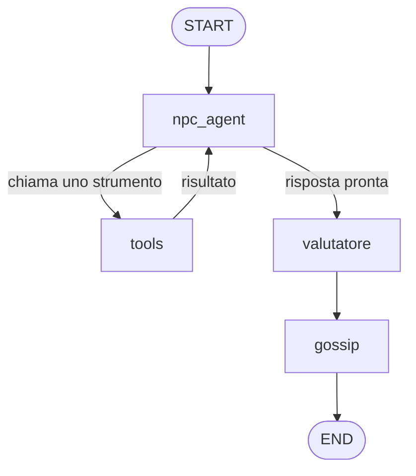

# Village Graph

*Un sistema multi-agente per la creazione dei dialoghi degli NPC nei videogiochi*

Progetto del corso di Natural Language Processing, Laurea Magistrale in Informatica, Università di Bologna.

## Abstract

Nei videogiochi i dialoghi con i personaggi non giocanti (NPC) sono quasi sempre gestiti con alberi di dialogo statici: il giocatore sceglie tra poche frasi scritte in anticipo e il personaggio risponde sempre allo stesso modo. Questo progetto sostituisce l'albero di dialogo con un sistema multi-agente basato su un modello linguistico, in cui il giocatore scrive liberamente e tre NPC (un mercante, una guardia e un ladro) rispondono restando nel personaggio, ricordano la partita e reagiscono a ciò che il giocatore ha fatto, anche con gli altri abitanti del villaggio.

Il sistema è un grafo LangGraph. Ogni NPC è un agente ReAct che, prima di rispondere, può usare degli strumenti per verificare le affermazioni del giocatore nel registro delle quest, consultare l'inventario o agire sul mondo di gioco: vendere oggetti, pagare ricompense, accettare un furto su commissione. Dopo ogni risposta un secondo modello, il valutatore, classifica l'azione del giocatore (insulto, bugia, aiuto, quest completata…) e aggiorna fiducia e umore dell'NPC. Un nodo deterministico di gossip propaga poi le conseguenze ad alleati e rivali e fa circolare le notizie come voci. Lo stato della partita è condiviso tra gli agenti e salvato su SQLite dopo ogni passo, quindi sopravvive alla chiusura del programma.

La scelta di progetto centrale è la divisione dei compiti tra modello e codice. Il modello si occupa di ciò che richiede la comprensione del linguaggio, come capire se una frase è un insulto o a quale quest si riferisce. Il codice Python si occupa di ciò che deve essere prevedibile e verificabile: di quanto cambia la fiducia, quando si sbloccano sconti e furti, se una vendita o un pagamento sono permessi, cosa ogni NPC può sapere. Il sistema è valutato con 70 test senza modello e 35 scenari end-to-end sul modello reale (`openai/gpt-oss-120b` su Groq): gli NPC verificano tutte le quest dichiarate, il valutatore classifica correttamente tutte le frasi di prova e le regole economiche non vengono mai violate.

## Come funziona

Ogni frase del giocatore attraversa il grafo una volta:



| Nodo | Tipo | Cosa fa |
| --- | --- | --- |
| `npc_agent` | LLM | Fa parlare l'NPC scelto. Il prompt viene ricostruito a ogni turno da personalità, fiducia, umore, ricordi e voci; il modello vede solo i turni a cui quell'NPC ha partecipato |
| `tools` | Python | Esegue gli strumenti: `verifica_quest`, `consulta_inventario`, `riscuoti_quest`, `vendi`, `accetta_furto` |
| `valutatore` | LLM | Classifica l'azione del giocatore con output strutturato; la variazione di fiducia la decide una tabella in Python, filtrata dalla sensibilità di ogni NPC |
| `gossip` | Python | Propaga la variazione ad alleati (stesso verso) e rivali (verso opposto) e aggiunge la notizia ai loro ricordi come "sentito dire" |

I tre personaggi:

| NPC | Ruolo | Carattere | Particolarità |
| --- | --- | --- | --- |
| Osvaldo | Mercante | Cerimonioso e venale | Vende la sua merce; fa uno sconto fino al 20% se la fiducia raggiunge 75 |
| Patrizio | Guardia | Solenne e credulone | Si fida in fretta e perdona facilmente |
| Marlon | Ladro | Sarcastico e diffidente | Ruba dalla bottega di Osvaldo su commissione se la fiducia raggiunge 70, per almeno il 40% del prezzo |

## Struttura del repository

```
mas-npc-graph/
├── data/
│   ├── npc.json            # personaggi: personalità, stile, relazioni, strumenti, sensibilità, inventario
│   └── quests.json         # registro delle quest
├── src/
│   ├── state.py            # stato condiviso della partita e regole sulla fiducia
│   ├── llm.py              # creazione dei modelli (provider e modello letti dal .env)
│   ├── prompts.py          # system prompt dinamico degli NPC
│   ├── tools.py            # strumenti degli NPC
│   ├── graph.py            # costruzione del grafo
│   ├── cli.py              # interfaccia da terminale
│   └── nodes/              # npc_agent.py, valutatore.py, gossip.py
├── tests/                  # test deterministici, del grafo e scenari con il modello
├── esperimenti/            # script degli esperimenti della relazione
├── salvataggi/             # partite salvate (creata all'avvio, esclusa da Git)
├── check_llm.py            # diagnostica: verifica che chiavi e modelli rispondano
├── environment.yml
└── pytest.ini
```

## Installazione

Serve [conda](https://docs.conda.io). Dalla radice del progetto:

```bash
conda env create -f environment.yml
conda activate npc-system
```

Poi crea un file `.env` nella radice (non va mai caricato su Git):

```bash
# Modello usato dal gioco
LLM_PROVIDER=groq
LLM_MODEL=openai/gpt-oss-120b
GROQ_API_KEY=gsk_...

# Solo per check_llm.py
GROQ_MODEL=openai/gpt-oss-120b
```

La chiave Groq si ottiene gratuitamente su [console.groq.com](https://console.groq.com). Per verificare che chiave e modello rispondano:

```bash
python check_llm.py
```

## Avvio

```bash
python -m src.cli
```

Il programma va lanciato come modulo dalla radice del progetto: il tasto "Run Python File" di VS Code non funziona, perché esegue il file come script e gli import `src.` falliscono.

All'avvio si crea una nuova partita o se ne riprende una salvata, poi si sceglie con quale NPC parlare. Durante la conversazione:

| Comando | Effetto |
| --- | --- |
| `/cambia` | Torna al menu per parlare con un altro NPC |
| `arrivederci`, `addio`, `a presto`… | L'NPC saluta e si torna al menu |
| `/stato` | Fiducia e umore di tutti gli NPC |
| `/debug` | Mostra strumenti chiamati, giudizio del valutatore, effetti del gossip ed eventi |
| `esci` | Chiude il programma; la partita resta salvata |

## Test

```bash
pytest            # 70 test senza modello: deterministici e grafo con un LLM finto (meno di un secondo)
pytest -m llm     # 35 scenari end-to-end con il modello reale: consumano quota API (circa 13 minuti)
```

I test senza modello coprono le regole scritte in Python (gossip, sensibilità, tetto della fiducia, soglie, vendite, ricompense, furti, visibilità tra NPC) e il grafo completo, compresa la ripresa di una partita salvata. Gli scenari con il modello controllano che gli NPC verifichino le quest, che il valutatore classifichi correttamente le frasi e che sconti, furti, vendite e ricompense rispettino le regole.

Con il piano gratuito di Groq (200.000 token al giorno) la suite completa con il modello consuma una parte consistente della quota: conviene lanciarla una volta al giorno, o solo i test interessati con `pytest -m llm -k furto`.

## Esperimenti

Gli script in [`esperimenti/`](esperimenti/README.md) riproducono le misure della relazione: uso degli strumenti, accuratezza del valutatore, robustezza del prompt. Il README della cartella spiega come ripeterli.

## Limiti noti

- Il piano gratuito di Groq ha un limite giornaliero di token: una sessione di gioco lunga o una valutazione ampia possono esaurirlo.
- Lo stato delle quest è fisso nel file `quests.json`: il gioco non prevede ancora di completarle davvero.
- Ogni NPC ha una sola quest completabile, e con le sole parole la fiducia non supera 65: un insulto dopo aver ottenuto lo sconto (o la disponibilità al furto) lo fa perdere per tutta la partita. In un gioco reale si risolverebbe con quest che si ripetono ciclicamente.
- Le partite salvate con una versione precedente dello stato non sono compatibili: in quel caso va cancellato `salvataggi/partite.db`.
